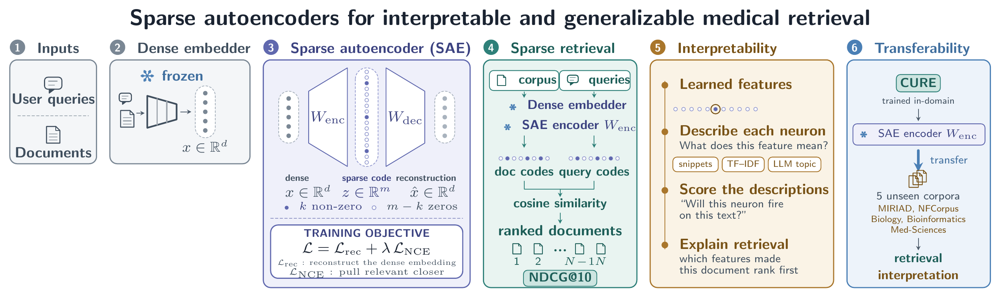

[](https://www.apache.org/licenses/LICENSE-2.0)
[](https://arxiv.org/abs/2611.18179)
[](https://huggingface.co/doctolib-lab)
[](https://github.com/doctolib-lab/medsae/actions/workflows/ci.yml)


# MedSAE <br />Explanations that Transfer: Interpreting Medical Retrieval with Sparse AutoEncoders



This repository contains the implementation of the ML4H 2026 paper [*Explanations that Transfer: Interpreting
Medical Retrieval with Sparse AutoEncoders*](https://arxiv.org/abs/2611.18179).

MedSAE makes dense medical retrieval interpretable. A TopK sparse autoencoder (SAE) is trained on the frozen
embeddings of a text encoder with two objectives: reconstruct each embedding, and keep queries close to their
relevant documents through an InfoNCE loss on the sparse codes. Documents are then ranked by cosine similarity of
codes that have at most k active features, and every feature can be described from the texts that activate it:
top snippets, TF IDF terms and a topic written by an Interpreter LLM. Trained on CURE, the sparse codes improve in
domain retrieval over the original embeddings and lose less than their dense counterparts out of domain,
especially on corpora far from the training one. Descriptions built on CURE alone still predict where a feature
fires on five unseen corpora, and they explain single retrievals: which concepts made one passage outrank another.

### Repository layout 🗂️

| Folder | What it holds |
| --- | --- |
| [`package/`](package) | the `medsae` Python package: datasets, embedding, training, evaluation, interpretation, command line, tests and examples |
| [`paper/`](paper) | the code that produced the numbers of the paper: data preparation, embedding, sweeps, out of domain evaluation and the interpretability pipeline |
| [`annotation_app/`](annotation_app) | the Streamlit app used to collect clinician judgments of feature descriptions (code only, no annotations) |


> [!WARNING]
> This library is in active development. Its API may change without notice before version 1.0. If you would like
> to collaborate, please open an issue or start a discussion.


### 01 Install 🚀

MedSAE needs Python 3.11 or newer and is tested on Linux and macOS. A GPU is advised for CURE (244,600
passages); the small examples run on a laptop CPU.

```bash
pip install medsae
pip install "medsae[llm]"          # optional: LLM descriptions through any OpenAI compatible server
pip install "medsae[local-llm]"    # optional: local LLM such as google/medgemma-4b-it
```

To work on the code, install it from source:

```bash
git clone https://github.com/doctolib-lab/medsae.git
cd medsae/package
pip install -e ".[dev,llm]"        # add local-llm for a local LLM such as google/medgemma-4b-it
```

#### Post installation check

```bash
medsae --version
python -c "import medsae; print(medsae.__version__)"
```

### 02 MedSAE step by step ➡️

The snippets below chain into one script. [`package/examples/01_quickstart.py`](package/examples/01_quickstart.py)
runs the same steps on NFCorpus with a small encoder, in a few minutes on a laptop CPU.

#### 1️⃣ Load a dataset 💽

Six medical retrieval benchmarks are registered: `cure` (the training set of the paper), `nfcorpus`, `miriad`,
`r2med_biology`, `r2med_bioinformatics` and `r2med_medical_sciences`. They are downloaded from the Hugging Face Hub
at pinned revisions, with the splits of the paper. Your own data loads with `medsae.load_beir_folder`.

```python
from medsae import list_datasets, load_dataset

print(list_datasets())
dataset = load_dataset("nfcorpus")  # prints the license and terms of the dataset once
print(dataset.describe())
```

#### 2️⃣ Embed it with a frozen encoder 🧊

`Embedder` wraps a sentence transformers model. Queries of the BGE v1.5 models get the retrieval instruction of
their model card, the one the paper used for `BAAI/bge-large-en-v1.5`; MedEmbed and other models get none. The
embeddings record the encoder and its settings, so that an SAE trained on them later embeds new queries the same
way. A local copy of a model loads with `Embedder(folder, name="BAAI/bge-large-en-v1.5")`, which records the Hub
id rather than the folder.

```python
from medsae import Embedder

embedder = Embedder("BAAI/bge-large-en-v1.5")
data = embedder.embed_dataset(dataset)  # corpus and queries of every split, as float32 arrays
data.save("runs/nfcorpus/embeddings")   # reload later with EmbeddedDataset.load(path, dataset)
```

#### 3️⃣ Choose an SAE from the Hub, or create one 🎛️

The checkpoints of the paper are on the Hub, one repository per encoder and one folder per k (see
[04](#04-pretrained-sparse-autoencoders-)).

```python
import torch

from medsae import MedSAE, load_pretrained

pretrained = load_pretrained("bge", k=64)  # doctolib-lab/medsae-bge-large-en-v1.5/k64_m3072

# A new SAE with m = 3d features and k = 64 active ones, the setting of Tables 2 and 3 of the paper
torch.manual_seed(42)                   # reproducible initial weights
sae = MedSAE(d_in=data.dim, n_latents=3 * data.dim, k=64, embedder=data.embedder)
```

#### 4️⃣ Train it 🏋️

`TrainingConfig` defaults follow the paper: Adam with learning rate 5 × 10⁻⁴, batches of 512, 100 epochs, query
reconstruction weight 0.1, and validation NDCG@10 on the full corpus every 100 steps to keep the best checkpoint,
which is also written to `output_dir` at every improvement. The paper picks the InfoNCE weight λ in {0, 5 × 10⁻⁶,
10⁻⁵} and the temperature τ in {0.01, 0.05, 0.1} per k on validation NDCG@10; the defaults λ = 10⁻⁵ and τ = 0.05
are one point of that grid.

```python
from medsae import Trainer, TrainingConfig

trainer = Trainer(sae, TrainingConfig(), output_dir="runs/nfcorpus/sae").fit(data)
sae = trainer.best_model
```

#### 5️⃣ Evaluate retrieval 🎯

`evaluate` ranks the whole corpus for every query by cosine similarity and computes NDCG@10 exactly as the paper
does. Pass `None` instead of an SAE to score the original dense embeddings.

```python
from medsae import evaluate

print(evaluate(None, data, split="test"))  # original embeddings
print(evaluate(sae, data, split="test"))   # sparse codes: ndcg@10, recall@100, mrr@10, n_queries
```

#### 6️⃣ Interpret the features 🔍

The `Interpreter` selects features that fire on enough documents and queries and writes one card per feature: top
documents and queries, negatives, TF IDF terms and, with an LLM, a topic, a description and keywords.
`Interpreter.score` then asks an Activation Prediction LLM whether each feature fires on held out texts, in domain or
on another dataset, and reports Pearson r, the metric of Table 3 of the paper, and AUROC (an extra metric, not in
the paper).

```python
from medsae import Interpreter, OpenAICompatibleLLM, TransformersLLM

interpreter = Interpreter(sae, data, split="train")
features = interpreter.select_features(n=20)
llm = OpenAICompatibleLLM("my-model", base_url="http://localhost:8000/v1")  # any OpenAI compatible server
# llm = TransformersLLM("google/medgemma-4b-it")                          # the paper's LLM, gated on the Hub
cards = interpreter.describe(features, llm=llm)
interpreter.save_cards(cards, "runs/nfcorpus/cards.json")
print(cards[0].to_markdown())

report = interpreter.score(cards, llm)  # in domain; data=other_embedded_dataset scores out of domain
print(report.to_frame())                # mean Pearson r and AUROC per interpretation type
```

The protocol of Table 3 of the paper interprets a CURE checkpoint on the CURE training passages and queries:
every qualifying feature, in the order of `select_features(theme_column="source_folder")` (most theme specific
first) with no `n`, described and judged by `TransformersLLM()` (`google/medgemma-4b-it`). The cards are scored in
domain with `score(cards, llm)`, then once per out of domain dataset with `score(cards, llm, data=ood)`. The order
of the features drives both seeded draws of the scoring, so another order judges other texts.
[`package/examples/03_interpret_features.py`](package/examples/03_interpret_features.py) runs that recipe.

#### 7️⃣ Explain one retrieval 💡

As in Figure 2 of the paper, the cosine similarity of two codes splits into one contribution per feature;
`explain` shows the features whose contributions differ most between two passages, named after their cards.

```python
from medsae import search

indices, scores = search(sae, data.queries["test"][:1], data.corpus, top_k=10)  # first test query
query = dataset.queries["test"].text.iloc[0]
doc_a, doc_b = (dataset.corpus.text.iloc[i] for i in indices[0, [0, 9]])      # ranked 1 and 10
print(interpreter.explain(query, doc_a, doc_b, cards=cards))
```

### 03 Command line 💻

Every step has a command, and every command maps to the Python API above (`medsae <command> --help` names the
function it calls).

```bash
medsae datasets                                  # list the registered benchmarks
medsae embed --dataset nfcorpus --model BAAI/bge-small-en-v1.5 --output runs/nfcorpus/embeddings
medsae train --dataset nfcorpus --embeddings runs/nfcorpus/embeddings --k 32 --output-dir runs/nfcorpus/sae
medsae evaluate --dataset nfcorpus --embeddings runs/nfcorpus/embeddings                          # dense
medsae evaluate --dataset nfcorpus --embeddings runs/nfcorpus/embeddings --sae runs/nfcorpus/sae  # sparse
medsae interpret --dataset nfcorpus --embeddings runs/nfcorpus/embeddings --sae runs/nfcorpus/sae \
    --output runs/nfcorpus/features --n-features 20
medsae interpret --dataset nfcorpus --embeddings runs/nfcorpus/embeddings --sae runs/nfcorpus/sae \
    --output runs/nfcorpus/features --n-features 20 --llm openai --llm-model MODEL \
    --base-url http://localhost:8000/v1 --score --score-on r2med_biology   # LLM labels, scored out of domain
medsae explain --dataset nfcorpus --embeddings runs/nfcorpus/embeddings --sae runs/nfcorpus/sae \
    --cards runs/nfcorpus/features/cards.json --query "..." --doc-a "..." --doc-b "..."
medsae pretrained --embedder bge --k 64          # id of a pretrained checkpoint
medsae convert runs/paper/bge_k64 checkpoints/bge-k64 --embedder bge   # paper checkpoint to MedSAE folder
medsae push checkpoints/bge-k64 my-org/medsae-bge-k64 --license cc-by-nc-4.0   # private unless --public
```

### 04 Pretrained sparse autoencoders 🤗

The checkpoints of the paper are in the [MedSAE collection](https://huggingface.co/collections/doctolib-lab/medsae)
of the Hugging Face Hub, in the [`doctolib-lab`](https://huggingface.co/doctolib-lab) organisation: one repository
per encoder, and in it one folder per configuration `k{k}_m{m}` (`sae.safetensors` and `cfg.json`, with the
training settings and the CURE scores of that checkpoint). All are trained on CURE, seed 42.

| Encoder | Alias | Repository | Interpretability (Figure 1) | Retrieval |
| --- | --- | --- | --- | --- |
| `BAAI/bge-large-en-v1.5` | `bge` | [`doctolib-lab/medsae-bge-large-en-v1.5`](https://huggingface.co/doctolib-lab/medsae-bge-large-en-v1.5) | `k64_m3072` | `k256_m3072` |
| `abhinand/MedEmbed-large-v0.1` | `medembed` | [`doctolib-lab/medsae-medembed-large-v0.1`](https://huggingface.co/doctolib-lab/medsae-medembed-large-v0.1) | `k64_m3072` | `k256_m3072` |
| `gemini-embedding-001` | `gemini` | [`doctolib-lab/medsae-gemini-embedding-001`](https://huggingface.co/doctolib-lab/medsae-gemini-embedding-001) | `k128_m9216` | `k256_m9216` |

```python
from medsae import list_pretrained, load_pretrained

print(list_pretrained())            # every checkpoint id, such as doctolib-lab/medsae-bge-large-en-v1.5/k64_m3072
sae = load_pretrained("bge", k=64)  # k picks the folder; without k, the smallest one
sae = load_pretrained(repo_id="doctolib-lab/medsae-bge-large-en-v1.5/k256_m3072")  # a full id, no listing
```

Loaded checkpoints record their encoder and the query instruction the paper embedded with, so
`Embedder.from_sae(sae)` rebuilds the matching encoder.

Publishing your own checkpoint takes one command, private by default so it can be reviewed before it goes public.
It writes a repository that `load_pretrained(repo_id=...)` reads too:

```bash
hf auth login                                               # a token with write access to the organisation
medsae convert runs/paper/bge_k64 checkpoints/bge-k64 --embedder bge   # or a folder written by medsae train
medsae push checkpoints/bge-k64 my-org/medsae-bge-k64
```

Weights inherit the terms of their training data. Every checkpoint trained on CURE is released under
`cc-by-nc-4.0` (noncommercial), the license of CURE, whatever the license of this code. The trainer records the
dataset license in the checkpoint and the model card picks it up; `medsae push --license` overrides it.

### 05 Results from the paper 📊

NDCG@10 (%) with `BAAI/bge-large-en-v1.5`, mean ± 95% confidence interval over three seeds (Table 1 of the paper).
The SAEs are trained on CURE only; the other five datasets are out of domain. `original` ranks with the dense
embeddings, `dense` is an SAE whose k equals the embedding dimension (1024).

| BGE | CURE | NFCorpus | MIRIAD | R2MED Bioinformatics | R2MED Biology | R2MED Medical Sciences |
| --- | --- | --- | --- | --- | --- | --- |
| original | 53.06 | 38.17 | 77.24 | 27.04 | 12.72 | 27.78 |
| k = 64 | 57.07 ± 1.25 | 31.89 ± 0.59 | 68.75 ± 0.49 | 22.50 ± 1.61 | 8.30 ± 2.93 | 22.72 ± 2.93 |
| k = 128 | 59.35 ± 0.35 | 34.48 ± 3.70 | 71.83 ± 1.54 | 27.42 ± 3.21 | 9.76 ± 2.91 | 26.60 ± 3.39 |
| k = 256 | 60.50 ± 1.02 | 35.61 ± 0.08 | 73.85 ± 0.92 | 28.10 ± 0.89 | 10.06 ± 1.17 | 29.05 ± 0.80 |
| dense (k = 1024) | 61.87 ± 0.55 | 36.62 ± 0.29 | 75.05 ± 0.36 | 27.21 ± 1.98 | 8.37 ± 0.65 | 27.33 ± 1.72 |

<details>
<summary>MedEmbed and Gemini embeddings</summary>

| MedEmbed | CURE | NFCorpus | MIRIAD | R2MED Bioinformatics | R2MED Biology | R2MED Medical Sciences |
| --- | --- | --- | --- | --- | --- | --- |
| original | 52.46 | 37.13 | 76.73 | 25.85 | 8.99 | 25.89 |
| k = 64 | 56.44 ± 0.84 | 31.84 ± 0.43 | 69.25 ± 1.17 | 22.51 ± 0.89 | 8.03 ± 2.04 | 22.48 ± 3.16 |
| k = 128 | 58.49 ± 0.43 | 34.22 ± 0.84 | 71.76 ± 1.61 | 25.78 ± 0.52 | 8.72 ± 3.18 | 25.32 ± 4.85 |
| k = 256 | 59.21 ± 1.08 | 35.85 ± 0.85 | 74.44 ± 1.12 | 28.05 ± 5.68 | 8.85 ± 1.81 | 24.88 ± 3.21 |
| dense (k = 1024) | 60.38 ± 0.52 | 32.59 ± 0.68 | 74.99 ± 0.31 | 22.61 ± 0.21 | 6.04 ± 0.97 | 21.99 ± 1.47 |

| Gemini | CURE | NFCorpus | MIRIAD | R2MED Bioinformatics | R2MED Biology | R2MED Medical Sciences |
| --- | --- | --- | --- | --- | --- | --- |
| original | 52.77 | 42.22 | 84.93 | 51.35 | 32.94 | 52.51 |
| k = 64 | 58.05 ± 1.33 | 32.98 ± 3.62 | 76.33 ± 3.79 | 39.84 ± 8.38 | 20.64 ± 8.57 | 39.57 ± 2.60 |
| k = 128 | 58.76 ± 0.47 | 35.19 ± 0.23 | 79.07 ± 0.45 | 41.48 ± 2.83 | 23.26 ± 1.30 | 44.23 ± 4.85 |
| k = 256 | 59.85 ± 0.45 | 37.42 ± 1.06 | 80.49 ± 0.78 | 44.80 ± 2.66 | 26.36 ± 1.59 | 47.86 ± 2.50 |
| dense (k = 3072) | 62.07 ± 0.73 | 37.73 ± 1.29 | 84.38 ± 0.68 | 46.53 ± 2.62 | 22.65 ± 3.75 | 38.67 ± 5.15 |

</details>

Every k beats the original embeddings in domain. Out of domain with BGE, going dense never helps on the R2MED
subsets, whose corpora differ most from CURE: k = 256 matches dense on all three, with higher means. MedEmbed
behaves the same way. With Gemini, dense keeps the best mean on Bioinformatics, within the confidence interval of
k = 256.

### 06 Reproducing the paper ⚙️

➡️ [`paper/README.md`](paper/README.md) holds the exact code behind the tables and figures: data preparation,
embedding, the training sweeps, out of domain evaluation and the interpretability pipeline. The package
reimplements the same method with the same defaults, and `medsae convert` turns any checkpoint of the paper code into
a MedSAE folder. [`package/examples/02_reproduce_cure.py`](package/examples/02_reproduce_cure.py) trains the SAE
setting of Tables 2 and 3 (BGE, k = 64, m = 3072) on CURE with the package and evaluates it as in Table 1; a GPU is
advised. [`package/examples/03_interpret_features.py`](package/examples/03_interpret_features.py) documents the
interpretation protocol of Table 3.

### 07 Annotation app 🩺

➡️ [`annotation_app/README.md`](annotation_app/README.md) describes the Streamlit app used to ask clinicians the
question the Activation Prediction LLM answers: given the description of a feature, would it fire on this passage?

### 08 Contribute 🤝

➡️ [read the contribution guidelines](CONTRIBUTING.md)

### 09 Citation 📚

```bibtex
@misc{bouchacourt2026explanationstransferinterpretingmedical,
      title={Explanations that Transfer: Interpreting Medical Retrieval with Sparse AutoEncoders},
      author={Diane Bouchacourt and Gaëtan Brison},
      year={2026},
      eprint={2611.18179},
      archivePrefix={arXiv},
      primaryClass={cs.IR},
      url={https://arxiv.org/abs/2611.18179},
}
```

### 10 License ⚖️

* Code: [Apache 2.0](LICENSE).
* Datasets keep their own licenses and are downloaded from the Hugging Face Hub at pinned revisions, never
  redistributed here: CURE (`clinia/CUREv1`, © 2024 Clinia) is `cc-by-nc-4.0`, noncommercial; NFCorpus is
  `cc-by-sa-4.0` on the Hub, but its original release is free for academic use only; MIRIAD is read from
  `tomaarsen/miriad-4.4M-split`, a split of `miriad/miriad-4.4M`, which is `odc-by` with the restrictions of the
  OpenAI terms of use (its questions were written by OpenAI models); the R2MED subsets are `cc-by-4.0`, and their
  queries are StackExchange posts (CC BY SA), to be attributed together with R2MED.
* SAE weights trained on CURE are `cc-by-nc-4.0` (noncommercial), like CURE itself, and their model cards repeat
  the terms of their training data.
* `google/medgemma-4b-it`, used as Interpreter and Activation Prediction LLM in the paper, has its own terms
  (Health AI Developer Foundations); accept them on the Hub before downloading it.

### 11 Responsible use ⚠️

MedSAE is a research tool. Feature descriptions are written by an LLM and can be wrong, and retrieval quality on
medical questions is far from perfect. Do not use MedSAE, its checkpoints or its explanations for diagnosis,
treatment or any other clinical decision.

### 12 Star history ⭐

[](https://star-history.com/#doctolib-lab/medsae&Date)
