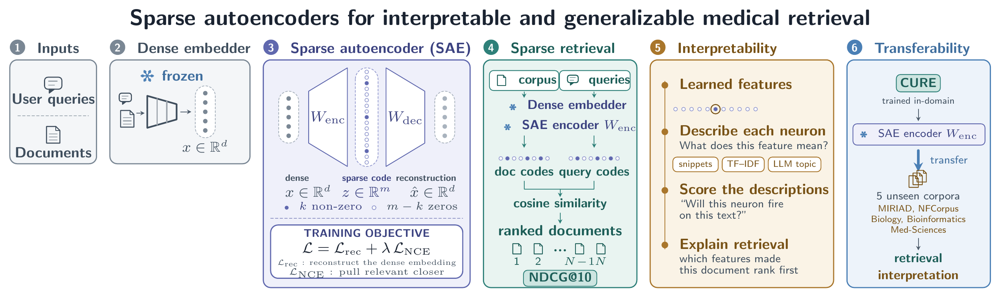

# DoctoSAE

**Sparse autoencoders for interpretable and transferable medical retrieval.** Reference implementation of the ML4H
2026 paper [*Explanations that Transfer: Interpreting Medical Retrieval with Sparse AutoEncoders*](https://arxiv.org/abs/2611.18179) (Diane Bouchacourt and
Gaëtan Brison).



DoctoSAE trains a TopK sparse autoencoder (SAE) on the frozen embeddings of a text encoder, with a reconstruction loss
and an InfoNCE loss that keeps queries close to their relevant documents. Documents are then ranked by cosine
similarity of codes with at most k active features, and every feature can be described from the texts that activate
it: top snippets, TF IDF terms and a topic written by an Interpreter LLM. These descriptions explain single
retrievals, and they transfer to corpora the SAE never saw.

> **Warning:** DoctoSAE is in active development and its API may change before version 1.0. It is a research tool:
> do not use it for diagnosis, treatment or any other clinical decision.

## Install

```bash
pip install doctosae
pip install "doctosae[llm]"        # optional: LLM descriptions through any OpenAI compatible server
pip install "doctosae[local-llm]"  # optional: local LLM such as google/medgemma-4b-it
```

DoctoSAE needs Python 3.11 or newer. A GPU is advised for CURE; the small examples run on a laptop CPU.

## Quickstart

Start from a checkpoint of the paper in the
[DoctoSAE collection](https://huggingface.co/collections/doctolib-lab/doctosae), with no training:

```python
from doctosae import Embedder, Interpreter, evaluate, load_dataset, load_pretrained

sae = load_pretrained("bge", k=256)                   # doctolib-lab/doctosae-bge-large-en-v1.5/k256_m3072
dataset = load_dataset("nfcorpus")                    # cure, miriad, r2med_biology, ...
data = Embedder.from_sae(sae).embed_dataset(dataset)  # the frozen encoder the SAE was trained on

print(evaluate(None, data, split="test"))  # dense embeddings: ndcg@10 0.382
print(evaluate(sae, data, split="test"))   # sparse codes: ndcg@10 0.357, as in Table 1 of the paper

interpreter = Interpreter(sae, data, split="train")
for card in interpreter.describe(interpreter.select_features(n=3)):
    print(card.to_markdown())
```

Or train your own SAE on the same embeddings, with the settings of the paper:

```python
from doctosae import DoctoSAE, Trainer, TrainingConfig

my_sae = DoctoSAE(d_in=data.dim, n_latents=3 * data.dim, k=64, embedder=data.embedder)
my_sae = Trainer(my_sae, TrainingConfig(), output_dir="runs/nfcorpus/sae").fit(data).best_model
```

The same steps from the command line, where `--sae` takes a Hub checkpoint id or a folder:

```bash
SAE=doctolib-lab/doctosae-bge-large-en-v1.5/k256_m3072
doctosae embed --dataset nfcorpus --sae $SAE --output runs/nfcorpus/embeddings
doctosae evaluate --dataset nfcorpus --embeddings runs/nfcorpus/embeddings --sae $SAE
doctosae interpret --dataset nfcorpus --embeddings runs/nfcorpus/embeddings --sae $SAE \
    --output runs/nfcorpus/features --n-features 20
doctosae train --dataset nfcorpus --embeddings runs/nfcorpus/embeddings --k 64 --output-dir runs/nfcorpus/sae
```

## What is inside

* `doctosae.load_dataset`: CURE, NFCorpus, MIRIAD and the three R2MED subsets, downloaded from the Hugging Face Hub
  at pinned revisions with the splits of the paper; `doctosae.load_beir_folder` for your own data.
* `doctosae.Embedder`: sentence transformers encoders; queries of the BGE v1.5 models get the retrieval instruction
  of their model card, the one the paper used for BGE large, and the embeddings record every setting.
* `doctosae.DoctoSAE`: the TopK SAE, saved and shared through the Hugging Face Hub (`save_pretrained`, `push_to_hub`,
  `from_pretrained`, `doctosae.load_pretrained`).
* `doctosae.Trainer`: the paper objective, sampler and checkpoint selection. The defaults are the values the paper
  holds fixed, and one point of its grid for the InfoNCE weight and temperature, which it selects per k.
* `doctosae.evaluate` and `doctosae.search`: retrieval on sparse codes, NDCG@10 computed as in the paper.
* `doctosae.Interpreter`: feature selection, feature cards, Interpreter and Activation Prediction LLMs (OpenAI
  compatible servers, local Transformers models), and retrieval explanations as in Figure 2 of the paper.
* `doctosae` command line: `datasets`, `pretrained`, `embed`, `train`, `evaluate`, `interpret`, `explain`, `push`,
  `convert`.

## Pretrained sparse autoencoders

The checkpoints of the paper, trained on CURE, are in the
[DoctoSAE collection](https://huggingface.co/collections/doctolib-lab/doctosae) of the Hugging Face Hub: one repository
per encoder, one folder per configuration.

| Encoder | Alias | Repository | Checkpoints |
| --- | --- | --- | --- |
| `BAAI/bge-large-en-v1.5` | `bge` | `doctolib-lab/doctosae-bge-large-en-v1.5` | `k64_m3072`, `k256_m3072` |
| `abhinand/MedEmbed-large-v0.1` | `medembed` | `doctolib-lab/doctosae-medembed-large-v0.1` | `k64_m3072`, `k256_m3072` |
| `gemini-embedding-001` | `gemini` | `doctolib-lab/doctosae-gemini-embedding-001` | `k128_m9216`, `k256_m9216` |

```python
from doctosae import load_pretrained

sae = load_pretrained("bge", k=64)    # doctolib-lab/doctosae-bge-large-en-v1.5/k64_m3072
sae = load_pretrained("gemini")       # the smallest k: doctolib-lab/doctosae-gemini-embedding-001/k128_m9216
```

The smallest k is the configuration the paper interprets, k = 256 the one that retrieves best. `doctosae pretrained`
lists every checkpoint id. Weights trained on CURE are `cc-by-nc-4.0` (noncommercial), the license of CURE.

## Results from the paper

NDCG@10 (%) with `BAAI/bge-large-en-v1.5`, SAEs trained on CURE, mean over three seeds (Table 1 of the paper):

| BGE | CURE | NFCorpus | MIRIAD | R2MED Bioinformatics | R2MED Biology | R2MED Medical Sciences |
| --- | --- | --- | --- | --- | --- | --- |
| original | 53.06 | 38.17 | 77.24 | 27.04 | 12.72 | 27.78 |
| k = 64 | 57.07 | 31.89 | 68.75 | 22.50 | 8.30 | 22.72 |
| k = 128 | 59.35 | 34.48 | 71.83 | 27.42 | 9.76 | 26.60 |
| k = 256 | 60.50 | 35.61 | 73.85 | 28.10 | 10.06 | 29.05 |
| dense (k = 1024) | 61.87 | 36.62 | 75.05 | 27.21 | 8.37 | 27.33 |

## Links

* Source code, paper code and full documentation: <https://github.com/doctolib-lab/doctosae>
* Examples: <https://github.com/doctolib-lab/doctosae/tree/main/package/examples>
* Issues: <https://github.com/doctolib-lab/doctosae/issues>
* Contributing: <https://github.com/doctolib-lab/doctosae/blob/main/CONTRIBUTING.md>

## Citation

```bibtex
@misc{bouchacourt2026explanationstransferinterpretingmedical,
      title={Explanations that Transfer: Interpreting Medical Retrieval with Sparse AutoEncoders},
      author={Diane Bouchacourt and Gaëtan Brison},
      year={2026},
      eprint={2611.18179},
      archivePrefix={arXiv},
      primaryClass={cs.IR},
      url={https://arxiv.org/abs/2611.18179},
}
```

## License

The code is released under the Apache 2.0 license. Datasets keep their own licenses and are downloaded from the
Hugging Face Hub at pinned revisions (CURE is `cc-by-nc-4.0`, noncommercial). SAE weights trained on CURE are
`cc-by-nc-4.0`.
